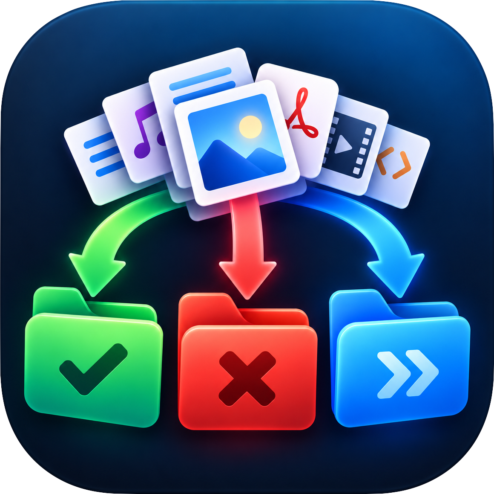
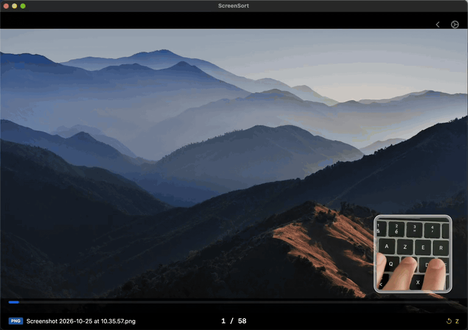
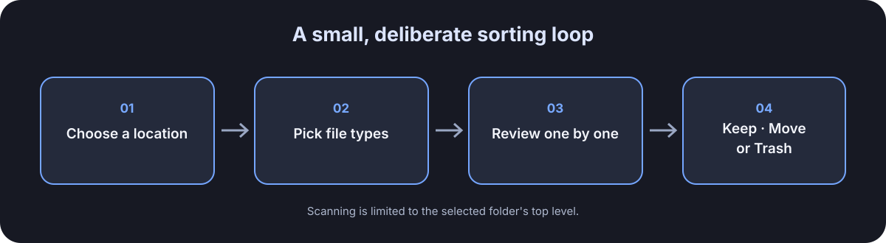
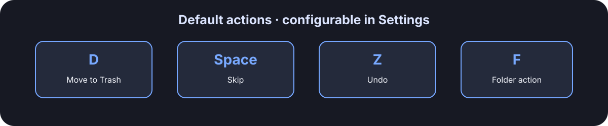
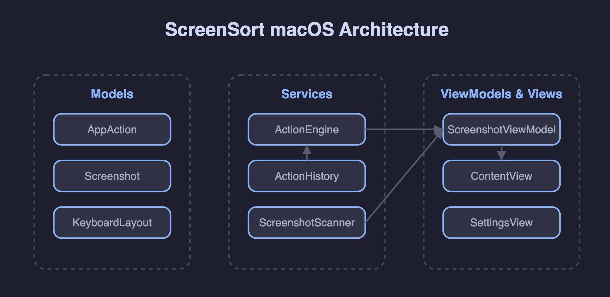

<p align="center"></p>

<h1 align="center">ScreenSort</h1>

<p align="center"><em>Sort your files, one decision at a time.</em></p>

<p align="center"><a href="https://github.com/Quantix-eng/screensort-macos/blob/main/Assets/demo.mp4"></a></p>

## Download and install

[**Download ScreenSort for Mac (.dmg)**](https://github.com/Quantix-eng/screensort-macos/releases/latest/download/ScreenSort.dmg)

1. Open the downloaded `ScreenSort.dmg` from Downloads.
2. In the window that appears, drag **ScreenSort** onto **Applications**.
3. Eject the ScreenSort disk image, then open the app from Applications.
4. The first launch may be blocked because this test build is not notarized. Open **System Settings → Privacy & Security**, scroll to Security, and choose **Open Anyway** for ScreenSort. Confirm the prompt, then launch it again. [Apple's guide](https://support.apple.com/en-gb/guide/mac-help/mh40617/27/mac/27) has screenshots of this step.

This build is ad-hoc signed and does not need a paid Apple Developer account. macOS will still show an unidentified-developer warning. Only use the download linked above. A Developer ID signature and notarization would remove that warning but require Apple Developer Program membership.

The package targets macOS 13 or later. This first packaged build is for testing and has not been checked across every supported macOS version; folder access, permissions, and undo behavior still need more edge-case review.

A small macOS app for reviewing a pile of files one at a time. I use it to clear my Desktop: usually around 150 items in a weekly session, with an occasional pass through another folder.

The workflow is simple: choose a location and file types, review each match, then leave it in place, move it, or send it to Trash with a keypress.

> The current name is provisional. There are other apps using “ScreenSort” or offering related file-sorting workflows; see [Related tools](#related-tools).

## The flow





The default bindings are configurable. Shortcuts are handled while the app is active; they are not system-wide hotkeys.

## What it does

- Scans the top level of the Desktop, Desktop and Pictures, or a folder you choose. Hidden files are skipped.
- Filters by screenshots, screen recordings, images, PDFs, documents, presentations, spreadsheets, archives, folders, or all files.
- Shows matching items one by one and moves to the next item after an action.
- Sends unwanted items to the macOS Trash, moves items to a selected destination, or leaves them in place when skipped.
- Keeps a short undo history for recent moves and Trash actions.
- Detects common QWERTY, AZERTY, and Dvorak keyboard layouts and shows the matching key labels. You can still choose a layout manually.
- Shows a brief shortcut reminder when a sorting session starts. Sorting shortcuts pause while Settings is open.

The scanner does not search inside nested folders. Folder scanning, permissions, and undo behavior still need more edge-case review before I would call this release-ready.

## Why I made it

I wanted a quick way to make decisions about files that had accumulated on my Desktop without opening each one in Finder. It is useful in my own routine, even though the idea is not new. Similar tools already exist; the small distinction here is a manual, keyboard-led review of an existing folder rather than automatic rules or scheduled cleanup.

## Project structure



The app is a SwiftUI executable organized into models, scanning and file-action services, a view model, and views. The package manifest declares no third-party Swift package dependencies.

## Source build

The repository contains a Swift package. To build the executable from source, install Xcode or the Xcode Command Line Tools and run:

```sh
swift build -c release
```

The downloadable app is packaged separately as a macOS `.app` inside a disk image.

## Privacy and file access

The source currently contains no network client or analytics integration. File actions run through macOS `FileManager`. The app asks macOS to choose custom folders, but its long-term access behavior and sandbox configuration still need review. Back up important files before trying it on a large or irreplaceable folder.

## Related tools

This is a personal utility, not a claim that manual file triage is a new idea. For context, [FileSift](https://apps.apple.com/us/app/filesift/id6783454559?mt=12) offers keyboard-driven file sorting on Mac, and [DeskSweep](https://apps.apple.com/us/app/desksweep/id6744123600?mt=12) focuses on scheduled Desktop cleanup. The name ScreenSort is also used by screenshot-related apps on mobile, so I plan to settle on a distinct name before a public release.

## License

No license has been selected yet. Please do not reuse the code until one is added. The absence of third-party packages in `Package.swift` does not resolve the license for the project itself or prove that every generated line is free of third-party material.

*Implementation note: I used Cursor and GitHub Copilot while developing the app.*

